<picture>
  <source
    media="(prefers-color-scheme: dark)"
    srcset="./dark.svg"
  />
  <source
    media="(prefers-color-scheme: light)"
    srcset="./light.svg"
  />
  
</picture>

<!-- Parth Thakre | GitHub Profile README -->

<picture>
  <source media="(prefers-color-scheme: dark)" srcset="./dark.svg">
  <source media="(prefers-color-scheme: light)" srcset="./light.svg">
  
</picture>

<h2 align="center">Hey, I'm Parth Thakre 👋</h2>

  <b>Software Engineer | Backend Engineering | DSA | Full-Stack Development</b>

  I'm passionate about software development, with a strong interest in building
  robust backend systems and exploring the possibilities of Generative AI.
  I enjoy solving complex problems, designing scalable solutions, and
  experimenting with emerging technologies.

  
  
  

---

## 👨‍💻 About Me

- 🎓 Student at **G. H. Raisoni College of Engineering, Nagpur**.
- 💻 Interested in backend engineering and building reliable software systems.
- 🧠 Solved **750+ problems on LeetCode**, primarily using C++.
- ⚙️ Worked with the MERN stack and backend technologies.
- 🔄 Interested in asynchronous processing, Redis and background job queues.
- 🐳 Familiar with Docker and Linux fundamentals.
- 🤖 Exploring Generative AI, AI Agents, RAG and Agentic AI.
- 📚 Continuously learning system design, data structures and software architecture.

I believe good software engineering is about more than writing code. It's about understanding problems, making thoughtful design decisions, and building systems that are reliable, maintainable and useful.

## ⚙️ Technical Skills

### 💻 Programming Languages

  

### 🌐 Full-Stack Development

  

### 🗄️ Backend & Databases

  

  
  

### 🧠 AI & Emerging Technologies

  
  
  
  

### 🛠️ Tools & Development Environment

  

### 📐 Computer Science & Engineering

- Data Structures and Algorithms
- Object-Oriented Programming
- Database Management Fundamentals
- System Design Fundamentals
- Backend Architecture
- REST API Development
- Authentication and Authorization
- Background Job Processing

---

## 🧩 Problem Solving

  

  <b>Consistency · Problem Solving · Data Structures · Algorithms</b>

C++ is my primary language for practicing Data Structures and Algorithms.

I enjoy tackling algorithmic challenges and strengthening my understanding of problem-solving patterns, complexity analysis and efficient solutions.

[Visit my LeetCode Profile →](https://leetcode.com/u/tparh/)

---

## 🎯 Areas of Interest

| Area | Interests |
|---|---|
| Backend Engineering | API design, backend architecture, reliable systems |
| Databases | MongoDB, Redis, data management |
| Asynchronous Systems | Background workers, job queues, BullMQ |
| System Design | Scalable architecture and engineering fundamentals |
| Problem Solving | DSA, algorithms, C++ |
| Artificial Intelligence | Generative AI, AI Agents, RAG, Agentic AI |
| Infrastructure | Docker, Linux fundamentals |

---

## 📊 GitHub

  
  

  

---

## 🤝 Let's Connect

  
  
  

  <i>Building strong fundamentals. Solving meaningful problems. Engineering better systems.</i>

